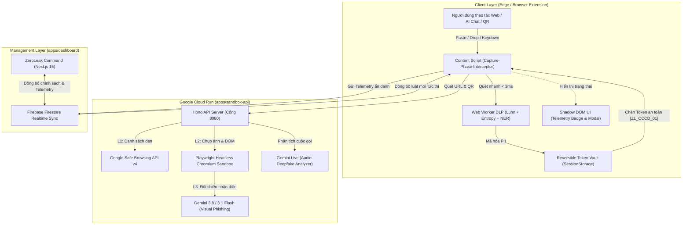

# 🛡️ ZeroLeak — Hybrid Edge-Cloud Security Platform

<div align="center">


[](https://devfest.gdg.vn)
[](https://zeroleak-sandbox-api-968014036408.asia-southeast1.run.app/health)
[](https://www.typescriptlang.org/)
[](https://opensource.org/licenses/MIT)

**"Zero Data Exposed. Zero Credentials Stolen."**

*Hệ thống bảo vệ dữ liệu nhạy cảm và chống lừa đảo trực tuyến đa phương thức thế hệ mới.*  
*Dự án tham dự cuộc thi **GDG DevFest Miền Trung 2026** (Chủ đề: An ninh mạng & Trí tuệ nhân tạo).*

[🚀 Trải nghiệm Demo](#-hướng-dẫn-cài-đặt--trải-nghiệm) • [🏛️ 3 Trụ Cột Kỹ Thuật](#-3-trụ-cột-kỹ-thuật-cốt-lõi) • [📊 Kiến Trúc Hệ Thống](#-kiến-trúc-hệ-thống) • [☁️ Cloud Run API](#-dịch-vụ-cloud-run-đang-hoạt-động) • [🎬 Video Demo](#-video-demo)

</div>

---

## 🎬 Video Demo & Giới thiệu
- **Video 2 phút:** [`Demo-ZeroLeak-2Phut-BanGiamKhao.mp4`](Demo-ZeroLeak-2Phut-BanGiamKhao.mp4)
- **Phụ đề:** [`Demo-ZeroLeak-Subtitles.srt`](Demo-ZeroLeak-Subtitles.srt) / [`Demo-ZeroLeak-Subtitles.ass`](Demo-ZeroLeak-Subtitles.ass)

---

## ☁️ Dịch vụ Cloud Run đang hoạt động
Dịch vụ Cloud Sandbox & Multimodal AI đã được triển khai chính thức trên Google Cloud:
* **Production Endpoint:** `https://zeroleak-sandbox-api-968014036408.asia-southeast1.run.app`
* **Kiểm tra trạng thái (Health Check):**
  ```bash
  curl https://zeroleak-sandbox-api-968014036408.asia-southeast1.run.app/health
  ```

---

## 🌟 3 Trụ Cột Kỹ Thuật Cốt Lõi

ZeroLeak kết hợp sức mạnh bảo mật tại rìa (**Edge Security**) với trí tuệ nhân tạo đa phương thức trên đám mây (**Cloud Multimodal AI**) để giải quyết 3 thách thức an ninh mạng cấp bách:

### 1. 🔒 ZeroLeak Vault — On-Device DLP & Reversible Tokenization
Bảo vệ người dùng và doanh nghiệp trước nguy cơ rò rỉ dữ liệu nhạy cảm (CCCD Việt Nam, Thẻ tín dụng, Khóa bí mật API, PII) khi tương tác với các công cụ AI (ChatGPT, Claude, Gemini) hoặc web form.
* **100% On-Device:** Toàn bộ quá trình quét DLP diễn ra cục bộ trong Browser Extension thông qua Web Worker, **tuyệt đối không gửi bất kỳ byte dữ liệu thô nào ra khỏi máy**.
* **Độ trễ cực thấp (<3ms):** Kiến trúc phân tầng gồm Tầng 1 Deterministic (Regex tối ưu + Luhn Checksum + Shannon Entropy) và Tầng 2 Contextual AI NER.
* **Mã hóa hai chiều (Reversible Tokenization):** Tự động thay thế dữ liệu nhạy cảm bằng token ẩn danh an toàn (`[ZL_CCCD_01]`, `[ZL_KEY_01]`, `[ZL_PER_01]`) trước khi dán vào chatbox; và tự động khôi phục lại dữ liệu gốc trên màn hình hiển thị bằng `MutationObserver` mà không làm lộ dữ liệu trong ngữ cảnh chat tiếp theo.
* **Shadow DOM Isolation:** Toàn bộ Telemetry Badge và thông báo được cô lập trong Shadow DOM, không bị ảnh hưởng bởi CSS của trang web đích.

### 2. 👁️ ZeroLeak Lens — Cloud Sandbox & Visual Phishing Threat Intel
Phát hiện và ngăn chặn các cuộc tấn công mạo danh thương hiệu ngân hàng và cơ quan chính phủ Việt Nam (MBBank, Vietcombank, Techcombank, VNeID, Dịch vụ công) từ đường dẫn URL hoặc mã QR.
* **Tầng 1 (Fast Blacklist Check):** Tích hợp **Google Safe Browsing API v4** để lọc tức thì các mối đe dọa đã được công bố.
* **Tầng 2 (Playwright Headless Sandbox trên Cloud Run):** Mở liên kết đáng ngờ trong môi trường cô lập, áp dụng bộ lọc chống tấn công SSRF nội bộ, trích xuất cấu trúc DOM form/input và chụp ảnh màn hình WebP nhẹ.
* **Tầng 3 (Visual Phishing AI với Gemini Multimodal):** Sử dụng **Gemini 3.8 Flash** (kèm cơ chế dự phòng thông minh **Gemini 3.1 Flash Lite / 3.5 Flash Lite**) đối chiếu logo, màu sắc nhận diện và bố cục giao diện với tên miền thực tế để phát hiện tấn công Zero-day chỉ trong `<2.5s`.
* **Interactive QR Snipper:** Cho phép người dùng khoanh vùng và quét trực tiếp mã QR trên bất kỳ màn hình nào để giải mã và kiểm tra sandbox trước khi truy cập.

### 3. 🎙️ ZeroLeak Voice — Audio Deepfake & Scam Script Detector
Phòng chống các kịch bản lừa đảo công nghệ cao qua cuộc gọi thoại và giọng nói nhân tạo.
* **Phát hiện giọng nói nhân tạo (Synthetic Voice / Deepfake):** Đánh giá đặc trưng âm học, độ trễ và dấu hiệu của mô hình chuyển văn bản thành giọng nói (TTS) / Voice Cloning.
* **Nhận diện kịch bản thao túng tâm lý (Scam Script):** Sử dụng **Gemini 3.8 Live Extended Thinking** phát hiện các chiêu thức lừa đảo phổ biến tại Việt Nam:
  * Giả danh cơ quan công an, viện kiểm sát, tòa án đe dọa khởi tố.
  * Giả giọng lãnh đạo doanh nghiệp (CEO Fraud) yêu cầu chuyển tiền gấp.
  * Đòi hỏi cung cấp mã OTP, thông tin đăng nhập hoặc quét mã QR độc hại.
* Cung cấp cảnh báo bằng tiếng Việt trực quan kèm trích đoạn bằng chứng để người dùng phòng tránh kịp thời.

---

## 📊 Kiến Trúc Hệ Thống



---

## 📂 Cấu Trúc Monorepo (`pnpm workspaces`)

```text
ZeroLeak/
├── apps/
│   ├── extension/          # Browser Extension Manifest V3 (WXT + React 19 + TypeScript + TailwindCSS)
│   │   ├── components/     # Shadow DOM UI (TelemetryBadge, PhishingModal, Toast)
│   │   ├── entrypoints/    # Content scripts, Background service worker, Popup, Voice UI
│   │   └── utils/          # DLP Deterministic Engine, Reversible Vault, QR Snipper, Phishing Client
│   ├── sandbox-api/        # Cloud Sandbox API (Hono + Playwright Headless + Google GenAI SDK)
│   │   ├── src/            # Playwright Sandbox, Safe Browsing v4, Gemini Visual & Voice Analyzer
│   │   └── Dockerfile      # Dockerfile tối ưu hoá cho Google Cloud Run
│   └── dashboard/          # Quản trị điều hành thời gian thực (Next.js 15 App Router + Shadcn UI + Recharts)
├── packages/
│   ├── shared-types/       # Hợp đồng dữ liệu TypeScript chung (DlpScanResult, PhishingAnalysis, etc.)
│   └── firebase-config/    # Cấu hình Firebase & Realtime Sync Bus cho Policy/Telemetry
├── Dockerfile              # Dockerfile gốc hỗ trợ Cloud Run Source Deploy
├── firestore.rules         # Bộ quy tắc bảo mật Cloud Firestore đảm bảo Zero Knowledge
├── pnpm-workspace.yaml     # Cấu hình Monorepo Workspace
└── TEST_DATA.md            # Bộ kịch bản & dữ liệu mẫu phục vụ kiểm thử nghiệm thu
```

---

## 🚀 Hướng Dẫn Cài Đặt & Trải Nghiệm

### Yêu Cầu Môi Trường
* **Node.js:** `>= 22.0.0`
* **pnpm:** `>= 11.0.0`
* Trình duyệt nền tảng Chromium (Google Chrome, Microsoft Edge, Brave)

### 1. Cài Đặt Dependencies
Tại thư mục gốc của dự án:
```bash
pnpm install
```

### 2. Cấu Hình Biến Môi Trường
Tạo file `.env` từ file mẫu `.env.example`:
```bash
cp .env.example .env
```
Điền các khóa cấu hình cần thiết:
* `GEMINI_API_KEY`: Khóa API từ [Google AI Studio](https://aistudio.google.com/)
* `GOOGLE_SAFE_BROWSING_API_KEY`: Khóa API Safe Browsing từ [Google Cloud Console](https://console.cloud.google.com/)
* `SANDBOX_API_URL`: Mặc định trỏ về Cloud Run đã triển khai `https://zeroleak-sandbox-api-968014036408.asia-southeast1.run.app` (hoặc `http://localhost:8080` khi chạy cục bộ).

### 3. Biên Dịch & Nạp Extension Vào Chrome
```bash
# Biên dịch Extension (đầu ra tại apps/extension/.output/chrome-mv3)
pnpm --filter @zeroleak/extension build
```
**Cách nạp Extension vào trình duyệt:**
1. Mở Chrome và điều hướng đến: `chrome://extensions/`
2. Bật công tắc **"Chế độ dành cho nhà phát triển" (Developer mode)** ở góc trên bên phải.
3. Bấm nút **"Tải tiện ích đã giải nén" (Load unpacked)**.
4. Chọn đường dẫn: `apps/extension/.output/chrome-mv3`.

### 4. Chạy Môi Trường Phát Triển Cục Bộ (Tùy Chọn)
```bash
# Chạy Extension ở chế độ Hot-Reload
pnpm --filter @zeroleak/extension dev

# Chạy Cloud Sandbox API tại http://localhost:8080
pnpm --filter @zeroleak/sandbox-api dev

# Chạy Next.js Dashboard tại http://localhost:3000
pnpm --filter @zeroleak/dashboard dev

# Kiểm tra toàn bộ kiểu dữ liệu TypeScript
pnpm -r typecheck
```

---

## ☁️ Triển Khai Lên Google Cloud Run

Dịch vụ `sandbox-api` có thể được triển khai trực tiếp lên Google Cloud Run chỉ với 1 câu lệnh bằng Google Cloud SDK:

```bash
gcloud run deploy zeroleak-sandbox-api \
  --source . \
  --region asia-southeast1 \
  --allow-unauthenticated \
  --port 8080 \
  --memory 2Gi \
  --cpu 2 \
  --set-env-vars="NODE_ENV=production,GEMINI_MODEL_VISION=gemini-3.1-flash-lite,GEMINI_API_KEY=YOUR_GEMINI_API_KEY,GOOGLE_SAFE_BROWSING_API_KEY=YOUR_SAFE_BROWSING_KEY"
```

---

## ✅ Kịch Bản Kiểm Thử Nghiệm Thu (Definition of Done)

Hệ thống đã vượt qua 6 bài kiểm tra chuẩn mực trước khi thuyết trình:

* [x] **Test 1 (Edge DLP Latency):** Dán văn bản chứa 2 số CCCD, thẻ Visa chuẩn Luhn và API Key vào ChatGPT $\rightarrow$ Xử lý ẩn danh thành `[ZL_CCCD_01]` với thời gian hiển thị trên Telemetry Badge `<3ms`.
* [x] **Test 2 (Reversible Restoration):** Khi AI phản hồi có chứa token, giao diện tự động khôi phục lại giá trị thực với huy hiệu màu xanh lục bảo vệ.
* [x] **Test 3 (Phishing Sandbox Analysis):** Quét mã QR hoặc link mạo danh MBBank $\rightarrow$ Playwright chụp ảnh, Gemini nhận diện thương hiệu mạo danh và cảnh báo đỏ `MALICIOUS` trong `<2.5s`.
* [x] **Test 4 (Realtime Policy Sync):** Đổi luật trên Dashboard từ `AUTO_TOKENIZE` sang `STRICT_BLOCK` $\rightarrow$ Extension nhận diện tức thì mà không cần tải lại trang.
* [x] **Test 5 (Offline Resilience):** Khi ngắt mạng hoặc server bận, bộ lọc On-Device DLP vẫn vận hành 100% trơn tru tại máy người dùng.
* [x] **Test 6 (Audio Deepfake & Scam):** Kiểm tra tệp âm thanh giả giọng lãnh đạo/công an đòi OTP $\rightarrow$ Nhận diện chính xác kịch bản thao túng tâm lý và cảnh báo tiếng Việt.

---

## 🛡️ Nguyên Tắc Bảo Mật Bất Khả Xâm Phạm

1. **Zero Raw PII Exfiltration:** Dữ liệu cá nhân nhạy cảm không bao giờ rời khỏi thiết bị người dùng.
2. **Capture-Phase Interception:** Chặn sự kiện dán ở giai đoạn sớm nhất (`capture: true`) tương thích hoàn hảo với ProseMirror (ChatGPT, Claude, Gemini).
3. **Shadow DOM Isolation:** Cô lập hoàn toàn giao diện tiêm vào trang web, tránh xung đột CSS.
4. **SSRF Guard:** Sandbox API nghiêm cấm truy cập dải IP nội bộ (`10.0.0.0/8`, `192.168.0.0/16`, `127.0.0.1`, Google Metadata IP).

---

## 📄 Bản Quyền
Dự án được phân phối dưới giấy phép **MIT License**. Xem thêm tại [LICENSE](LICENSE).
